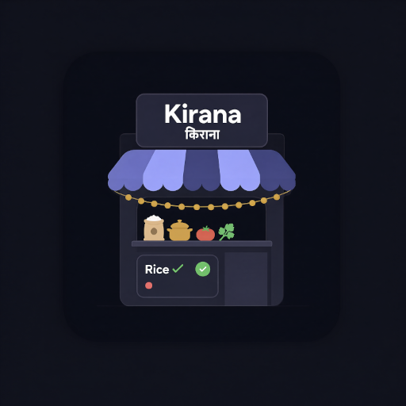

# Kirana

<div align="center">



[](https://opensource.org/licenses/MIT)

</div>

Self-hosted, installable web app for a single household's shopping board.
One shared list per store, grouped by aisle, with a multilingual catalog so
the second time you add "atta" it takes three taps.

**Status:** v1.0.0-rc — P0–P5 complete. Spec: `docs/PRD.md` (the frozen v1
specification); current state: `docs/STATUS.md`.

## Deploy from scratch (~10 minutes)

Prerequisites: Docker with Compose v2. That's it — no database, no reverse
proxy required.

```sh
git clone https://github.com/1decodemaster/kirana.git
cd kirana
cp .env.example .env
# Required: a cookie-signing secret
sed -i "s/change-me/$(openssl rand -hex 32)/" .env
docker compose up --build -d
curl localhost:8080/healthz        # → {"status":"ok",...}
```

Open http://localhost:8080 — the first-run wizard walks you through
household name → passcode → your name → optional starter data → first
store. Every family member then opens the same URL, taps their name, and
enters the passcode. Install it to the home screen from the browser menu
(PWA); it works offline and syncs when connectivity returns.

### HTTPS

Terminate TLS in front of the app and set `APP_ORIGIN` to the public origin
— session cookies are marked `Secure` only when `APP_ORIGIN` is https. A
minimal Caddy example ships in `infra/Caddyfile`.

### Configuration (PRD §12.1)

| Var | Default | Purpose |
| --- | --- | --- |
| `PORT` | `8080` | HTTP port |
| `DATA_DIR` | `/data` | DB + backups |
| `DATABASE_URL` | `${DATA_DIR}/kirana.db` | SQLite path |
| `APP_ORIGIN` | `http://localhost:8080` | Cookie `Secure` + CORS |
| `SESSION_SECRET` | _(required)_ | Cookie signing |
| `LOG_LEVEL` | `info` | pino level |
| `TZ` | `UTC` | Log timestamps only; data is always UTC |
| `BACKUP_KEEP_DAILY` | `14` | Daily backup retention |
| `LOGIN_RATE_LIMIT` / `MUTATION_RATE_LIMIT` | `5` / `120` | §11 limits (test-harness overrides; leave defaults) |
| `FEATURE_LLM`, `LLM_BASE_URL`, `LLM_MODEL` | off/empty | P6 only — no effect in v1 |

### Updates

```sh
git pull
docker compose up --build -d
```

Schema migrations run automatically on boot and are backward-safe; backups
(above) are your rollback.

## Backups (PRD §12.4)

Nightly at 03:00 via host cron (requires the `sqlite3` CLI on the host):

```cron
0 3 * * * DATA_DIR=/path/to/kirana/data /path/to/kirana/infra/backup.sh
```

Retention: 14 daily + 8 weekly. An on-demand backup (same format, same
retention) is available any time from **Settings → Data → Create backup**
(`POST /admin/backup`). Backups are WAL-safe snapshots — copy the `.gz`
anywhere you like.

### Restore drill (verified in P5)

1. `docker compose stop`
2. Move the current DB aside: `mv data/kirana.db{,.moved}`
   (also `-wal`/`-shm` files if present)
3. Restore: `gunzip -c data/backups/kirana-YYYYMMDD-HHMMSS.db.gz > data/kirana.db`
4. `docker compose start` — verify `/healthz` and that Home shows the same
   counts as before.

Measured in the P5 drill: **RTO 1.6s** (gate: ≤10 min). The drill used the
same SQLite backup API the app's backup feature uses.

## Locked out?

The passcode protects against casual access on a trusted LAN — it is not
strong authentication (PRD §11). Anyone with host access can read the
database directly. If the passcode is lost, reset it from the host; data is
untouched:

```sh
# Compose deployment (runs inside the container):
docker compose exec kirana node /app/node_modules/@kirana/db/dist/cli.js \
  reset-passcode --passcode NEWCODE

# Local dev (repo checkout):
DATABASE_URL="$PWD/data/kirana.db" node db/dist/cli.js reset-passcode --passcode NEWCODE
```

Then sign in with `NEWCODE` and pick your member. Databases from before
passcode auth shipped (pre-P4) always need this reset once.

## Privacy

No telemetry, no analytics, no third-party scripts, no external fonts. The
app works with the WAN unplugged. All data stays in your `data/` directory.
Logs are structured JSON with request ids; they contain no passcodes or
cookie material.

## Browser support

Last two versions of iOS Safari, Chrome Android, Firefox, and desktop
Chrome/Safari (PRD NFR-13). Installability (PWA) targets iOS Safari and
Chrome Android.

## Development

Requires Node 22 and pnpm (via corepack).

```sh
pnpm install
pnpm verify     # build + typecheck + lint + unit tests
pnpm dev        # server on :8080, web on :5173 (proxies /api)
pnpm build && pnpm e2e   # Playwright suite against the built app
```

Performance budgets are enforced by committed tests
(`server/__tests__/board.perf.test.ts`, `server/__tests__/nfr2.perf.test.ts`,
`web/src/lib/searchIndex.test.ts`, `e2e/specs/nfr-perf.spec.ts`); the full
NFR harness runs with `pnpm exec tsx scripts/perf-nfr.ts` (after `pnpm build`).

## Repo map

- `shared/` — Zod contracts, domain utilities (contract territory)
- `db/` — SQLite schema, SQL migrations, seeds
- `server/` — Fastify API
- `web/` — React SPA
- `e2e/` — Playwright flows
- `infra/` — backup script, Caddy example
- `docs/` — `STATUS.md` (start here), phase logs, ADRs, PRD
